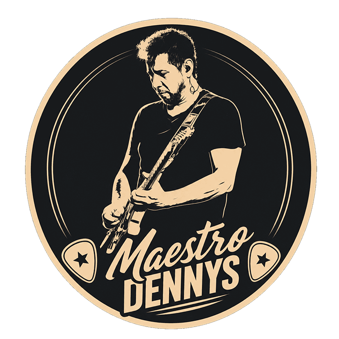

<p align="center">
  
</p>

<h1 align="center">DGuitar · Maestro Dennys</h1>

<p align="center">
  <strong>Aprende guitarra y bajo viendo el mástil, no solo leyéndolo.</strong><br/>
  Escalas, acordes, armonización e improvisación en una sola app.
</p>

<p align="center">
  
  
  
  
</p>

---

> **DGuitar** es una app didáctica de guitarra y bajo creada como homenaje al
> maestro **Dennys Ruiz**, guitarrista de **Mariara, Venezuela**. Muestra en el
> mástil lo que suena, explica el *por qué* de cada nota y convierte la teoría
> musical en algo que se ve, se escucha y se toca.

## Novedades

- **Onboarding una sola vez**: la primera vez eliges guitarra o bajo; después
  entras al **panel de módulos** para elegir Acordes, Escalas, Progresión,
  Improvisación o Afinación, y puedes volver a él desde cualquier módulo.
- **Módulos de aprendizaje**: panel con portadas propias, acceso directo a cada
  sección y botón para cambiar de instrumento sin reiniciar el recorrido.
- **Improvisación más completa**: varias progresiones guardadas por instrumento,
  metrónomo con acento, capas independientes de escala/acorde/colores/grados,
  tónica y escala configurables, y la posibilidad de tocar el mástil para
  escuchar cada nota, también en guitarra.
- **Progresiones guiadas**: catálogo de progresiones por género (pop, rock,
  jazz, blues, andaluza, menor y clásica) con escala sugerida, transposición
  instantánea a cualquier tonalidad y botón **Practicar** que abre el mástil con
  metrónomo y la capa de escala ya configurados.
- **Sonido SF2**: sampler SoundFont 2 propio con dos bancos incluidos
  (guitarra acústica y bajo YR), selector en Ajustes, importación de otros
  `.sf2` y vuelta al sintetizador Karplus–Strong.
- **Afinador mejorado**: modo automático con detección de cuerda, modo manual,
  indicador **EN TONO** y manejo del permiso de micrófono.
- **Círculo armónico**: tríadas o séptimas, selección de grados y cambio de
  calidad (diatónica, mayor o menor) manteniendo pulsado.
- **Rendimiento**: el mástil cachea geometría, voicings y modelo de dibujo para
  no recalcular por frame; la improvisación reutiliza su línea de tiempo.
- **Release optimizado**: R8 activo; el APK de release pesa ~7.1 MB frente a
  ~13 MB del debug.
- **Calidad**: tests unitarios del dominio y GitHub Actions para tests, lint y
  build.
- **Textos centralizados** en `strings.xml`, listos para futuras traducciones.

## Ficha rápida

| | |
|---|---|
| **Plataforma** | Android nativo (Kotlin) |
| **Compatibilidad** | Android 8.0 en adelante (API 26+) |
| **Instrumentos** | Guitarra 6 cuerdas · Bajo 4 y 5 cuerdas |
| **Afinaciones** | Estándar, Drop D, medio tono abajo, DADGAD, Open G, Open E |
| **Escalas** | 51 escalas y modos |
| **Acordes** | 24 tipos de acorde |
| **Improvisación** | 40–220 BPM · progresiones guardadas · metrónomo |
| **Progresiones guiadas** | 13 progresiones por género · transposición libre |
| **Sonido** | 2 SF2 incluidos (guitarra/bajo) + importación |
| **Tests** | Dominio, audio, geometría del mástil y playback |
| **CI** | GitHub Actions (tests + lint + build) |
| **Release** | R8 activo (~7.1 MB) |
| **Idioma** | Español |

## Contenido

1. [Novedades](#novedades)
2. [Escalas](#escalas)
3. [Acordes](#acordes)
4. [Armonización](#armonización)
5. [Progresiones guiadas](#progresiones-guiadas)
6. [Improvisación](#improvisación)
7. [Sonido](#sonido)
8. [Otras herramientas](#otras-herramientas)
9. [Calidad y pruebas](#calidad-y-pruebas)
10. [Cómo ejecutar](#cómo-ejecutar)
11. [Estructura del proyecto](#estructura-del-proyecto)
12. [Sobre Dennys Ruiz](#sobre-dennys-ruiz)

---

## Escalas

Las escalas se dibujan sobre el mástil con la tónica, los grados (1, b3, 5…)
y la fórmula de intervalos. Puedes escuchar la escala completa en secuencia,
subiendo y bajando, y ver las posiciones del patrón CAGED. Al abrir por primera
vez se parte de la **pentatónica menor**; puedes cambiar de escala, tónica,
patrón, colores y grados desde la barra superior.

Algunas escalas base:

| Escala | Fórmula | Uso típico |
|---|---|---|
| Mayor (Jónica) | 1–2–3–4–5–6–7 | Base tonal, melodía y armonía |
| Menor natural (Eólica) | 1–2–b3–4–5–b6–b7 | Rock, pop y baladas |
| Menor armónica | 1–2–b3–4–5–b6–7 | Sonido clásico y oriental |
| Menor melódica | 1–2–b3–4–5–6–7 | Jazz y fusión |
| Pentatónica menor | 1–b3–4–5–b7 | Solos de rock y blues |
| Blues menor | 1–b3–4–b5–5–b7 | Fraseo de blues |
| Dórico | 1–2–b3–4–5–6–b7 | Funk, jazz y rock modal |
| Mixolidio | 1–2–3–4–5–6–b7 | Dominantes y blues |
| Frigio dominante | 1–b2–3–4–5–b6–b7 | Flamenco y metal |

<details>
<summary><strong>Ver el catálogo completo (51 escalas y modos)</strong></summary>

- **Pentatónicas y blues:** pentatónica menor, mayor, menor 6, menor 9,
  dominante y frigia; blues menor, blues mayor, blues mayor b3; voodoo.
- **Mayores y menores:** mayor (jónica), menor natural (eólica), menor
  armónica, menor melódica, mayor armónica, menor melódica b6.
- **Modos griegos:** jónico, dórico, frigio, lidio, mixolidio, eólico, locrio.
- **Bebop y simétricas:** bebop dominante, mayor y menor; cromática; tonos
  enteros; disminuida (semitono-tono); disminuida (tono-semitono); aumentada
  mayor.
- **Alteradas y dominantes:** alterada (superlocria), lidio dominante,
  mixolidia b6.
- **Modales derivadas:** jónica #5, dórica b2, lidio #2, locria #2,
  locrio natural 6, menor melódica b5.
- **Éxoticas y étnicas:** frigia dominante (española), doble armónica
  (bizantina), húngara (gitana), napolitana menor, oriental, persa,
  rumana (menor húngara), pelog, hindú, enigmática, gitana menor.

</details>

---

## Acordes

Se dibujan las notas del acorde, su formación y sus grados. En guitarra puedes
**puntear** el acorde nota por nota y explorar las posiciones del sistema CAGED.

| Familia | Acordes incluidos |
|---|---|
| **Tríadas** | Mayor, Menor, 5 (power), Disminuido, Aumentado, Sus2, Sus4 |
| **Séptimas** | 7, Maj7, m7, dim7, m7b5, mMaj7, 7#5, maj7#5, dimMaj7, 7sus2, 7sus4 |
| **Extensiones** | 6, m6, add9, 9, m9, Maj9 |

Cada acorde muestra su **cifrado** (C, Am, G7…), su **nombre completo** y sus
**notas reales** coloreadas por función armónica.

---

## Armonización

El **círculo armónico** construye automáticamente los acordes de una escala de
7 notas, en tríadas o en séptimas, grado por grado (I, ii, iii, IV, V, vi, vii°).

Ejemplo en **Do mayor**:

| Grado | Tríada | Séptima | Función |
|:---:|:---:|:---:|---|
| I | C | Cmaj7 | Tónica |
| ii | Dm | Dm7 | Subdominante / preparación |
| iii | Em | Em7 | Tónica relativa |
| IV | F | Fmaj7 | Subdominante |
| V | G | G7 | Dominante |
| vi | Am | Am7 | Tónica relativa |
| vii° | Bdim | Bm7b5 | Dominante / sensible |

En la app puedes:

- Elegir qué grados del círculo suenan.
- Alternar entre **tríadas** y **séptimas**.
- Cambiar la calidad de cada grado (diatónica, mayor o menor) manteniendo
  pulsado sobre el acorde.
- Ver las notas del acorde armónico y seguirlo en el mástil.

---

## Progresiones guiadas

El paso natural después de armonizar: un catálogo de progresiones comunes con
su escala sugerida para improvisar encima. Cada una se transpone al instante a
cualquier tonalidad y se puede practicar directamente.

| Progresión | Género | Escala sugerida |
|---|---|---|
| I–V–vi–IV · vi–IV–I–V | Pop | Mayor |
| I–IV–V | Rock | Mayor |
| I–vi–IV–V · I–IV–V–vi (cadencia rota) | Balada | Mayor |
| ii–V–I · I–vi–ii–V | Jazz | Mayor |
| iiø–V–i | Jazz menor | Menor armónica |
| 12-bar blues | Blues | Blues menor |
| i–VII–VI–V | Andaluza | Frigia dominante |
| i–VI–III–VII · i–iv–v | Menor | Menor natural |
| Canon I–V–vi–iii–IV–I–IV–V | Clásica | Mayor |

Al tocar **Practicar**, la progresión se carga en el módulo de improvisación con
el mástil, el metrónomo y la capa de escala activos, lista para sonar.

---

## Improvisación

Un laboratorio para crear progresiones por secciones y practicar sobre ellas:

- **Biblioteca por instrumento**: crea, renombra, elimina y cambia entre varias
  progresiones; guitarra y bajo guardan las suyas por separado.
- **Secciones y acordes** propios (tónica + calidad), con compases por acorde.
- **Tempo ajustable** entre **40 y 220 BPM**, recordado por instrumento.
- **Metrónomo** con acento en el primer tiempo.
- Por cada acorde:
  - **Nota principal:** toca solo la nota más grave (la raíz del acorde).
  - **Arreglo:** toca las notas del acorde en arpegio (por defecto).
  - **Toques por compás:** **8, 4, 2 o 1**, repartidos dentro del compás.
- **Capas independientes**: escala, notas del acorde, colores y grados se pueden
  mostrar u ocultar por separado.
- **Tónica y escala** de improvisación configurables; la tónica puede seguir
  automáticamente al primer acorde de la progresión.
- **Toca el mástil** para escuchar la nota, tanto en guitarra como en bajo.
- El mástil resalta el acorde actual y el siguiente mientras suena la progresión,
  con barra de progreso por compás.

---

## Sonido

La guitarra y el bajo pueden sonar con **samples reales** de SoundFont 2 además
del sintetizador Karplus–Strong. El motor es un sampler propio en Kotlin: lee el
SF2, selecciona la zona por nota, aplica transposición, loop y envolventes, y
mezcla las voces en el mismo `AudioTrack` de la app. Si el SF2 no carga, el
sonido cae automáticamente al sintetizador.

- **Incluidos**:
  - `Guitar Acoustic` (guitarra acústica, dominio público).
  - `Bass YR` (bajo eléctrico).
- **Selector**: Ajustes → **Sonido**, con el sintético, los SF2 incluidos para
  el instrumento actual y los SF2 importados.
- **Importación**: desde el mismo diálogo se puede cargar cualquier `.sf2` del
  dispositivo; se copia a la carpeta privada de la app y queda disponible para
  las próximas sesiones.
- Al cambiar de guitarra a bajo (o al revés), la app elige el banco incluido
  adecuado para el instrumento si el sonido actual no corresponde.

---

## Otras herramientas

- **Afinador cromático** con detección de tono en tiempo real:
  - modo **automático** que elige la cuerda más cercana con histéresis,
  - modo **manual** tocando una cuerda de la fila,
  - lectura de Hz y cents, tolerancia de ±5 cents e indicador **EN TONO**.
- **Audio** de cuerda pulsada (Karplus–Strong) y sampler SF2 opcional para
  escuchar cada nota, con modo bajo.
- **Secuencia** de escala (subida y bajada) y **púa** de acordes.
- **Patrones CAGED** seleccionables desde el mástil.
- **Colores por grado** y **badges de grados** para reconocer la función de cada
  nota de un vistazo.

---

## Calidad y pruebas

El proyecto incluye tests JVM para la lógica que no depende de Android:

- teoría musical, escalas, acordes y grados,
- posiciones, secuencias y patrones CAGED,
- círculo armónico y codecs de preferencias,
- improvisación, línea de tiempo, playback y reproductor de secuencias,
- geometría del mástil, voicings y detección de cejillas,
- analizador de tono (YIN), afinador y resolución de cuerda.

Comandos útiles:

```bash
./gradlew testDebugUnitTest   # tests unitarios
./gradlew lintDebug           # análisis estático
./gradlew assembleDebug       # APK de desarrollo
./gradlew assembleRelease     # APK release con R8
```

El flujo de **GitHub Actions** (`.github/workflows/android.yml`) ejecuta tests,
lint y build en cada push a `develop`/`main` y en cada pull request.

## Cómo ejecutar

Requisitos: **Android Studio** reciente, **JDK 17 o superior** y Android SDK
(compilación con API 37).

```bash
git clone git@github.com:jviersalas/maestro-dennys.git
```

1. Abre la carpeta del proyecto en Android Studio.
2. Espera la sincronización de Gradle.
3. Ejecuta en un emulador o dispositivo con **Android 8.0+**.

Compilar por consola:

```bash
./gradlew assembleDebug
```

El APK se genera como `maestro-dennys-debug.apk`.

Para una build de distribución:

```bash
./gradlew assembleRelease
```

El APK release se genera como `maestro-dennys.apk`, con **R8** y reducción de
recursos activos (~7.1 MB). El `debug` no se minifica y pesa más (~13 MB); es
normal.

> El archivo `keystore.properties` y los `.jks` **no** se versionan. La firma de
> release se configura localmente. Si publicas el APK, guarda
> `app/build/outputs/mapping/release/mapping.txt` para desofuscar futuros
> reportes de fallos.

---

## Estructura del proyecto

```
app/src/main/java/apk/mavier/dguitar/
├── core/audio/          Síntesis (Karplus–Strong), sampler SF2 y análisis de tono (YIN)
├── domain/
│   ├── model/           Música, escalas, acordes, CAGED, armonización,
│   │                    voicings, timeline, afinador
│   ├── repository/      Contratos de datos
│   └── usecase/         Casos de uso (círculo armónico, improvisación)
├── data/
│   ├── preferences/     Claves y codecs de preferencias
│   └── repository/      Implementación con SharedPreferences
└── presentation/
    ├── common/          Scheduler, reproductor de notas, menús y etiquetas
    ├── learning/        Panel de módulos de aprendizaje
    ├── main/            Mástil, escalas, acordes y diálogo del círculo armónico
    ├── improvisation/   Progresiones, ViewModel, playback y arpegio
    ├── tuner/           Afinador
    ├── onboarding/      Splash y selección de instrumento
    └── ui/              Vistas del mástil, geometría y modelo de render
```

Los tests JVM viven en `app/src/test/java/apk/mavier/dguitar/` y cubren dominio,
audio, geometría, playback y codecs. El flujo de CI está en
`.github/workflows/android.yml`.

---

## Sobre Dennys Ruiz

> **Dennys Ruiz** es guitarrista y maestro de música de **Mariara, estado
> Carabobo, Venezuela**. Ha dedicado su vida a enseñar guitarra combinando
> técnica, oído y armonía aplicada, formando a músicos de la región con un
> método cercano: primero se escucha, después se entiende, y por último se
> domina el mástil.
>
> Esta app nace como homenaje a su labor y a su manera de compartir la música.

<!-- Bio editable: añade aquí años de trayectoria, agrupaciones, grabaciones,
     reconocimientos o anécdotas que quieras destacar. -->

---

<p align="center">
  Hecho con respeto y cariño para la música de Mariara, Venezuela.<br/>
  <sub>Proyecto conmemorativo · DGuitar</sub>
</p>
